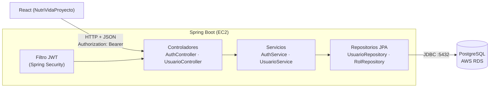
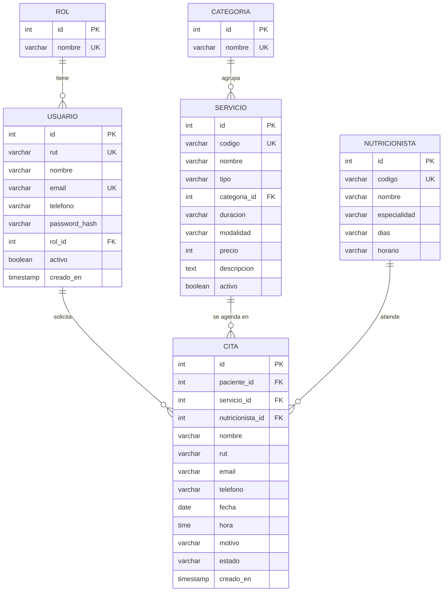
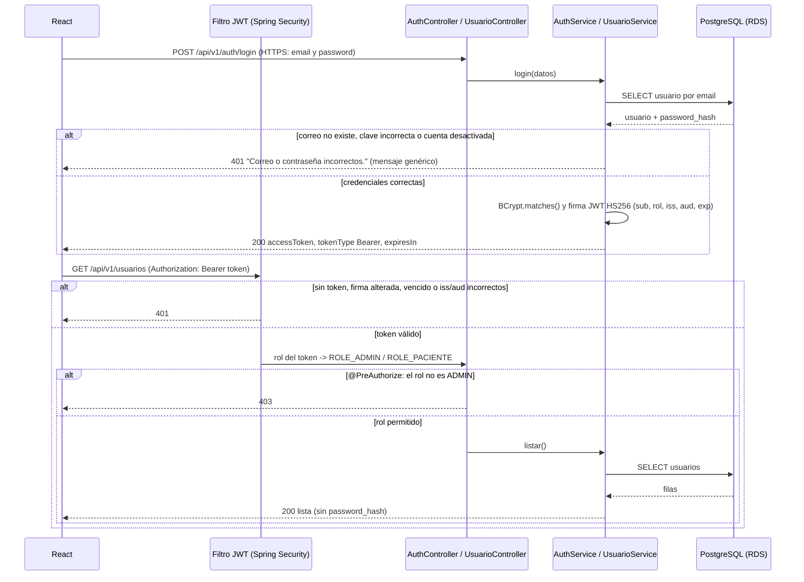

# 🥗 NutriVida - Backend Service (Spring Boot)

Este repositorio contiene la API REST y los servicios backend desarrollados con **Spring Boot** para la plataforma de la **Clínica Nutricional NutriVida**.

---

## 📌 Checklist de Entrega / Control de Avance

- [x] Creamos un repositorio nuevo para el backend y conservamos separado el frontend.
- [x] El README identifica proyecto, caso, alcance e integrantes.
- [x] El README del backend enlaza al frontend y el del frontend enlaza al backend.
- [x] Justificamos la tecnología elegida (Spring Boot) y su ejecución en EC2 o Lambda, según corresponda.
- [ ] Definimos la base de datos y mantenemos su diagrama actualizado, sin diccionario de datos.
- [x] Los diagramas en Drive tienen enlaces directos y acceso de lectura para el docente.
- [x] Explicamos las responsabilidades del backend y de los integrantes.
- [x] Iniciamos la estructura del proyecto, la conexión a datos y los primeros endpoints; indicamos el estado real de cada avance.
- [x] Documentamos la API con OpenAPI/Swagger y explicamos cómo consultarla y probar las rutas disponibles.
- [ ] Relacionamos las operaciones de la API con las funcionalidades del frontend.
- [x] Investigamos y justificamos la protección de contraseñas sin incluir credenciales reales.
- [x] Diseñamos el flujo JWT y los permisos, y distinguimos qué controles están implementados y cuáles pendientes.
- [x] Incluimos el diagrama de secuencia propio y consideramos los casos de rechazo.
- [ ] Registramos pruebas reales de los avances y separamos los resultados de los casos aún pendientes.
- [x] El README explica cómo ejecutar o desplegar y comprobar lo que ya está construido.
- [ ] Organizamos el trabajo para dos semanas y dejamos claros los siguientes pasos.
- [ ] Todos pueden explicar las decisiones, el código inicial y el avance del equipo.

---

## ℹ️ Identificación del Proyecto y Equipo

* **Proyecto:** NutriVida
* **Equipo:** Grupo N°3
* **Integrantes:**
  * Maximiliano Andrés Valenzuela Barrera - `max.valenzuelab@duocuc.cl`
  * Génesis Cerda - `gene.cerda@duocuc.cl`
  * Yoximar Ruiz - `yox.ruiz@duocuc.cl`
* **Caso:** Clínica Nutricional NutriVida
* **Alcance:** Proveer una API REST en **Java / Spring Boot** para la gestión persistente de contenidos, citas nutricionales, catálogo de servicios y autenticación de usuarios/pacientes, conectada a una base de datos PostgreSQL en AWS RDS y desplegada sobre infraestructura AWS (EC2 / Lambda).

---

## 🔗 Enlace al Repositorio Frontend

* **Repositorio Frontend:** [NutriVidaProyecto (React + Vite)](https://github.com/maxijrr20/NutriVidaProyecto.git)
* **Documentación ERS en Google Drive:** [Enlace a carpeta ERS en Drive](https://drive.google.com/drive/folders/1ncapMCk5xU48v4hHfm7bWwrtKheoQHpF?usp=drive_link)

---

## 🛠️ Tecnologías y Arquitectura Backend

* **Lenguaje:** Java 21
* **Framework:** Spring Boot 4.1 (Spring Web MVC, Spring Data JPA, Spring Security, Validation, driver PostgreSQL)
* **Gestor de dependencias:** Maven (wrapper `mvnw`)
* **Base de Datos:** PostgreSQL (AWS RDS - Subred Privada, Puerto 5432 aislado)
* **Servicios AWS:** EC2

* **Migraciones de base de datos:** Flyway (`src/main/resources/db/migration`)
* **Seguridad:** Spring Security + OAuth2 Resource Server (JWT HS256) + BCrypt
* **Documentación de la API:** springdoc-openapi (Swagger UI)

---

## ✅ Estado del trabajo (avance lunes 23 de noviembre)

| Operación | Ruta | Estado | Diseñado | Implementado | Probado (Swagger/Postman) |
| :--- | :--- | :--- | :---: | :---: | :---: |
| Tabla de usuarios (y roles) | Migración `V1__crear_tablas_rol_y_usuario.sql` | **Listo** | ✔ | ✔ | ✔ |
| Registro (crear usuario) | `POST /api/v1/auth/register` | **Listo** | ✔ | ✔ | ✔ |
| Inicio de sesión con JWT | `POST /api/v1/auth/login` | **Listo** | ✔ | ✔ | ✔ |
| Usuario actual | `GET /api/v1/auth/me` | **Listo** | ✔ | ✔ | ✔ |
| Listar usuarios | `GET /api/v1/usuarios` | **Listo** | ✔ | ✔ | ✔ |
| Ver un usuario | `GET /api/v1/usuarios/{id}` | **Listo** | ✔ | ✔ | ✔ |
| Modificar usuario | `PUT /api/v1/usuarios/{id}` | **Listo** | ✔ | ✔ | ✔ |
| Eliminar (desactivar) usuario | `DELETE /api/v1/usuarios/{id}` | **Listo** | ✔ | ✔ | ✔ |
| Crear usuario con rol (ADMIN) | `POST /api/v1/usuarios` | **Listo** | ✔ | ✔ | ✔ |
| Cambiar rol (ADMIN) | `PATCH /api/v1/usuarios/{id}/rol` | **Listo** | ✔ | ✔ | ✔ |
| Tablas de catálogo y citas | Migración `V2__crear_catalogo_y_citas.sql` | **Listo** | ✔ | ✔ | ✔ |
| Categorías (listar, crear, renombrar, eliminar) | `/api/v1/categorias` | **Listo** | ✔ | ✔ | ✔ |
| Catálogo de servicios (CRUD, borrado lógico) | `/api/v1/servicios` | **Listo** | ✔ | ✔ | ✔ |
| Nutricionistas (lectura) | `GET /api/v1/nutricionistas` | **Listo** | ✔ | ✔ | ✔ |
| Solicitar cita con regla de horario ocupado (409) | `POST /api/v1/citas` | **Listo** | ✔ | ✔ | ✔ |
| Listar / ver citas (el paciente solo las suyas) | `GET /api/v1/citas`, `GET /api/v1/citas/{id}` | **Listo** | ✔ | ✔ | ✔ |
| Cancelar y reprogramar cita (dueño o ADMIN) | `PATCH /api/v1/citas/{id}/cancelar`, `/reprogramar` | **Listo** | ✔ | ✔ | ✔ |
| Cambiar estado de una cita (ADMIN) | `PATCH /api/v1/citas/{id}/estado` | **Listo** | ✔ | ✔ | ✔ |
| Integración con el frontend React (registro e inicio de sesión) | `/api/v1/auth/*` | **Listo** | ✔ | ✔ | ✔ |
| Integración con el frontend React (catálogo, agendar, mis solicitudes, panel admin) | `/api/v1/servicios`, `/categorias`, `/nutricionistas`, `/citas` | **Listo** | ✔ | ✔ | ✔ |

> **Listo:** se probó en Swagger o Postman y el resultado quedó guardado en la base de datos. **En avance:** la ruta y su lógica están implementadas y con commits, pero falta registrar sus pruebas.

---

## 🗂️ Organización del backend (capas)



| Capa | Paquete | Qué hace |
| :--- | :--- | :--- |
| Controladores | `controller` | Reciben la solicitud HTTP, validan el cuerpo con `@Valid`, aplican `@PreAuthorize` y devuelven el estado HTTP. |
| Servicios | `service` | Reglas del negocio: correo y RUT únicos, rol asignado por el servidor, propietario o ADMIN, desactivación lógica. |
| Acceso a datos | `repository` | Consultas a PostgreSQL con Spring Data JPA. |
| Modelos y DTO | `model`, `dto` | Entidades de las tablas y datos de entrada y salida de la API (nunca se devuelve el hash). |
| Seguridad | `config/SecurityConfig`, `security` | BCrypt, emisión y verificación del JWT, CORS y respuestas 401/403. |
| Errores | `exception` | Convierte los errores en JSON con el estado correcto (400, 401, 403, 404, 409). |
| Validaciones | `validation` | `@RutValido`: formato y dígito verificador del RUT (módulo 11). |

---

## 🗃️ Modelo de datos (PostgreSQL)

Las tablas las crea Flyway con `V1__crear_tablas_rol_y_usuario.sql` y `V2__crear_catalogo_y_citas.sql`. Los servicios y nutricionistas iniciales son los mismos que usaba el frontend.



**Regla de horario ocupado:** un índice único parcial (`cita_horario_ocupado`) impide dos citas activas del mismo nutricionista en la misma fecha y hora; el servicio lo revisa antes y responde `409`. Una cita `Cancelada` o `Rechazada` libera el horario.

---

## 🔌 Endpoints implementados

Todas las rutas usan el prefijo versionado `/api/v1`. El detalle (cuerpos, ejemplos y errores) está en Swagger UI.

| Método y ruta | Quién puede usarla | Entrada | Éxito | Errores | Pantalla del frontend |
| :--- | :--- | :--- | :--- | :--- | :--- |
| `POST /api/v1/auth/register` | Público | `rut`, `nombre`, `email`, `telefono` (opcional), `password` | `201` usuario creado con rol `PACIENTE` | `400` datos inválidos · `409` correo o RUT ya registrados | `RegistroPage` |
| `POST /api/v1/auth/login` | Público | `email`, `password` | `200` `accessToken`, `tokenType: "Bearer"`, `expiresIn`, `usuario` | `400` campos vacíos · `401` "Correo o contraseña incorrectos." | `LoginPage` |
| `GET /api/v1/auth/me` | Con token | — | `200` datos del dueño del token | `401` | Navbar / sesión |
| `POST /api/v1/usuarios` | ADMIN | `rut`, `nombre`, `email`, `telefono` (opcional), `password`, `rol` | `201` usuario creado con el rol elegido | `400` · `401` · `403` · `409` correo o RUT ya registrados | `AdminUsuarios` |
| `GET /api/v1/usuarios` | ADMIN | — | `200` lista | `401` · `403` | `AdminDashboardPage` |
| `GET /api/v1/usuarios/{id}` | ADMIN o el mismo usuario | `id` | `200` | `401` · `403` cuenta ajena · `404` | Perfil / administración |
| `PUT /api/v1/usuarios/{id}` | ADMIN o el mismo usuario | `nombre`, `email`, `telefono`, `password` (opcional) | `200` | `400` · `401` · `403` · `404` · `409` correo de otra cuenta | Perfil / administración |
| `PATCH /api/v1/usuarios/{id}/rol` | ADMIN | `rol`: `ADMIN`, `NUTRICIONISTA` o `PACIENTE` | `200` usuario con el rol nuevo | `400` rol inválido · `401` · `403` · `404` · `409` el admin intenta quitarse su propio rol | `AdminUsuarios` |
| `DELETE /api/v1/usuarios/{id}` | ADMIN | `id` | `204` (desactivación lógica) | `401` · `403` · `404` · `409` el admin intenta desactivarse | `AdminDashboardPage` |
| `GET /api/v1/categorias` | Público | — | `200` categorías con `totalServicios` | — | `CategoriasPage`, `AdminCategorias` |
| `POST /api/v1/categorias` | ADMIN | `nombre` | `201` | `400` · `401` · `403` · `409` nombre repetido | `AdminCategorias` |
| `PUT /api/v1/categorias/{id}` | ADMIN | `nombre` | `200` (los servicios quedan con el nombre nuevo) | `400` · `401` · `403` · `404` · `409` | `AdminCategorias` |
| `DELETE /api/v1/categorias/{id}` | ADMIN | `id` | `204` | `401` · `403` · `404` · `409` tiene servicios | — |
| `GET /api/v1/servicios` | Público | `?categoria=` (opcional) | `200` servicios activos | — | `ServiciosPage`, `HomePage`, `CategoriaDetallePage` |
| `GET /api/v1/servicios/{id}` | Público | `id` | `200` | `404` | `DetalleServicioPage` |
| `POST /api/v1/servicios` | ADMIN | `nombre`, `categoria`, `precio`, `tipo`, `duracion`, `modalidad`, `descripcion` | `201` con código `SV0xx` asignado por el servidor | `400` datos inválidos o categoría inexistente · `401` · `403` | `AdminServicios` |
| `PUT /api/v1/servicios/{id}` | ADMIN | mismos campos | `200` | `400` · `401` · `403` · `404` | `AdminServicios` |
| `DELETE /api/v1/servicios/{id}` | ADMIN | `id` | `204` (borrado lógico: las citas antiguas lo conservan) | `401` · `403` · `404` | `AdminServicios` |
| `GET /api/v1/nutricionistas` | Público | — | `200` con días y jornada | — | `ContactoPage`, `ServiciosPage`, `AdminCriticos` |
| `POST /api/v1/citas` | Con token (cualquier rol) | `nombre`, `rut`, `email`, `telefono`, `servicioId`, `nutricionistaCodigo`, `fecha` (AAAA-MM-DD), `hora` (HH:MM), `motivo` | `201` en estado `Pendiente` | `400` fecha pasada, hora fuera de la jornada o fuera de bloques de 30 min · `401` · `404` servicio · `409` horario tomado | `ContactoPage` |
| `GET /api/v1/citas` | Con token | — | `200`: el PACIENTE recibe solo las suyas; ADMIN y NUTRICIONISTA, todas | `401` | `SolicitudEnCursoPage`, `AdminSolicitudes` |
| `GET /api/v1/citas/{id}` | Dueño, ADMIN o NUTRICIONISTA | `id` | `200` | `401` · `403` cita ajena · `404` | — |
| `PATCH /api/v1/citas/{id}/cancelar` | Dueño o ADMIN | — | `200` estado `Cancelada` (libera el horario) | `401` · `403` · `404` · `409` ya cancelada o rechazada | `SolicitudEnCursoPage` |
| `PATCH /api/v1/citas/{id}/reprogramar` | Dueño o ADMIN | `fecha`, `hora` | `200` estado `Reprogramada` | `400` · `401` · `403` · `404` · `409` horario tomado | `SolicitudEnCursoPage` |
| `PATCH /api/v1/citas/{id}/estado` | ADMIN | `estado`: `Pendiente`, `Confirmada`, `Reprogramada`, `Cancelada` o `Rechazada` | `200` | `400` · `401` · `403` · `404` · `409` al reactivar, el horario ya está tomado | `AdminSolicitudes` |

**Ejemplo de login (datos ficticios)**

```json
// Solicitud (cliente)
{ "email": "camila.rojas@correo.cl", "password": "Clave-segura-2026" }

// Respuesta 200 (servidor)
{
  "accessToken": "eyJhbGciOiJIUzI1NiJ9...",
  "tokenType": "Bearer",
  "expiresIn": 3600,
  "usuario": { "id": 2, "rut": "12345678-5", "nombre": "Camila Rojas", "email": "camila.rojas@correo.cl",
               "telefono": "+56912345678", "rol": "PACIENTE", "activo": true, "creadoEn": "2026-11-16T09:23:50" }
}
```

Campos que **genera el servidor**: `id`, `rol` (en el registro siempre `PACIENTE`), `activo`, `creadoEn`, `accessToken` y `expiresIn`. Si el cliente envía un `rol` en el registro, se ignora.

---

## 📘 Swagger UI (documentación viva)

* Local: `http://localhost:8080/swagger-ui.html`
* EC2: `http://34.224.151.181:8080/swagger-ui.html`
* Especificación OpenAPI en JSON: `/v3/api-docs`

Para probar una ruta protegida: ejecutar `POST /api/v1/auth/login`, copiar el `accessToken`, presionar **Authorize** y pegarlo (sin escribir "Bearer").

---

## 🔐 Seguridad

### Contraseñas: BCrypt

* Se guardan con **BCrypt** (`BCryptPasswordEncoder` de Spring Security) con **costo 12**. Nunca se guarda la contraseña en texto plano ni se devuelve el hash en la API.
* **Por qué BCrypt:** es un algoritmo hecho para contraseñas. Agrega una **sal aleatoria** a cada hash (dos usuarios con la misma clave tienen hashes distintos) y es **lento a propósito**: el costo 12 hace que probar millones de claves sea muy caro. Un hash rápido como SHA-256 no sirve para contraseñas. OWASP recomienda Argon2id como primera opción y acepta BCrypt con costo 10 o más cuando Argon2id no está disponible. Elegimos BCrypt porque viene incluido en Spring Security, sin dependencias extra.
* **Configuración:** costo 12 y contraseñas de 8 a 72 caracteres (BCrypt solo considera los primeros 72 bytes).
* **Fuentes:** [OWASP Password Storage Cheat Sheet](https://cheatsheetseries.owasp.org/cheatsheets/Password_Storage_Cheat_Sheet.html) · [Spring Security: Password Storage](https://docs.spring.io/spring-security/reference/features/authentication/password-storage.html)

### JWT

| Decisión | Valor |
| :--- | :--- |
| Quién emite y verifica | El mismo backend (`JwtService` emite; `SecurityConfig.jwtDecoder` verifica). |
| Algoritmo | HS256 (HMAC-SHA256). El verificador **solo acepta HS256**. |
| Clave de firma | Variable de entorno `JWT_SECRET` (mínimo 32 caracteres). No está en el repositorio ni en React. |
| Claims | `sub` (id del usuario), `rol`, `iss` = `nutrivida-backend`, `aud` = `nutrivida-frontend`, `iat`, `exp`. Sin contraseñas ni datos sensibles. |
| Vigencia | 60 minutos (`JWT_DURACION_MINUTOS`). Alcanza para agendar una cita sin exponer un token por días. |
| Qué se comprueba | Firma, algoritmo, `exp` (con 60 s de tolerancia de reloj), `iss` y `aud`. Además, en cada solicitud se comprueba que la cuenta siga activa. |
| Cierre de sesión y renovación | Primera versión sin refresh token: al vencer el token se vuelve a iniciar sesión. Cerrar sesión borra el token en el frontend; un token copiado sigue sirviendo hasta su `exp`, **salvo que la cuenta se desactive** (desde ese momento responde 401). |
| Token en el frontend | Pendiente de implementar en React. Se evaluará `sessionStorage` o `localStorage` para mantener la sesión al recargar (IE3.3.2), con su riesgo ante XSS. |
| CORS | Solo `http://localhost:5173` y `https://maxijrr20.github.io` (`CORS_ORIGENES`). CORS no reemplaza la autorización. |

**Roles y permisos (usuarios):** el registro público siempre asigna `PACIENTE`; solo el `ADMIN` puede crear usuarios con otro rol (`POST /usuarios`) o cambiar el rol de una cuenta (`PATCH /usuarios/{id}/rol`). Listar y desactivar son solo para `ADMIN` (`@PreAuthorize`, 403 para otros roles). Ver y modificar una cuenta lo pueden hacer el `ADMIN` o el mismo usuario: el id se compara con el `sub` del token, así que cambiar el id en la URL responde 403. El primer administrador se crea al iniciar con `ADMIN_EMAIL` y `ADMIN_PASSWORD`.

### Diagrama de secuencia: login y ruta protegida



---

## 🧪 Pruebas registradas

### Usuarios, roles y JWT (21/11/2026)

| # | Caso | Resultado esperado | Resultado obtenido |
| :--- | :--- | :--- | :--- |
| 1 | Registro con datos válidos | 201, rol `PACIENTE`, fila nueva en `usuario` con hash BCrypt |  201, rol `PACIENTE` ✔ |
| 2 | Registro con correo o RUT repetido | 409, sin usuario duplicado |  409 por correo y 409 por RUT ✔ |
| 3 | Registro con RUT inválido o contraseña corta | 400 con el error por campo |  400 con errores por campo ✔ |
| 4 | Registro enviando `"rol": "ADMIN"` | 201 con rol `PACIENTE` (el servidor ignora el rol) |  201 con rol `PACIENTE` ✔ |
| 5 | Login correcto | 200 con `accessToken`, `tokenType` y `expiresIn` |  200, `expiresIn` 3600 ✔ |
| 6 | Login con clave incorrecta o correo inexistente | 401 con el mismo mensaje genérico |  401 con el mismo mensaje en ambos casos ✔ |
| 7 | `GET /auth/me` sin token / con token alterado | 401 |  401 sin token y 401 con token alterado ✔ |
| 8 | `GET /usuarios` con token de PACIENTE | 403 |  403 (con token de ADMIN: 200 con la lista) ✔ |
| 9 | PACIENTE consulta `GET /usuarios/{id}` de otra persona | 403 |  403 al ver y 403 al modificar otra cuenta; 200 al modificar la propia ✔ |
| 10 | Reiniciar el backend y volver a iniciar sesión | Los usuarios siguen en la base de datos | Tras reiniciar, el ADMIN no se vuelve a crear (ya existe) y los usuarios de prueba siguen en PostgreSQL ✔ |
| 11 | ADMIN cambia el rol de un paciente a `NUTRICIONISTA` | 200 y el rol queda guardado |  200, rol `NUTRICIONISTA` ✔ |
| 12 | PACIENTE intenta `PATCH /usuarios/{id}/rol` | 403 |  403 ✔ |
| 13 | ADMIN intenta quitarse su propio rol | 409 |  409 ✔ |
| 14 | Frontend: registro e inicio de sesión llaman a la API (carga, éxito y error) | Mensajes visibles en pantalla | Registro exitoso, "Correo o contraseña incorrectos." con clave mala, login de PACIENTE y de ADMIN (redirige a `/admin`), sesión con token tras recargar y se borra al cerrar sesión ✔ |
| 15 | ADMIN crea un usuario `NUTRICIONISTA` (`POST /usuarios`) | 201 con el rol elegido | 201 ✔ |
| 16 | ADMIN desactiva un usuario | 204 | 204 ✔ |
| 17 | Usuario desactivado intenta iniciar sesión | 401 | 401 ✔ |

> Pruebas 1 a 13 y 15 a 17 ejecutadas el 21/11/2026 con `pruebas/probar-api.ps1` contra PostgreSQL local (detalle en `pruebas/resultados.md`). La 10 se comprobó reiniciando el backend y la 14 desde el navegador con React (`npm run dev`).

### Catálogo y citas (23/11/2026)

Ejecutadas con `pruebas/probar-catalogo-citas.ps1` contra PostgreSQL local: **31 de 31 OK** (detalle en `pruebas/resultados-catalogo-citas.md`).

| # | Caso | Resultado esperado | Resultado obtenido |
| :--- | :--- | :--- | :--- |
| C1–C3 | `GET /servicios`, `/categorias` y `/nutricionistas` sin iniciar sesión | 200 (lectura pública) | 200: 18 servicios, 4 categorías, 4 nutricionistas ✔ |
| C4–C5 | `POST /servicios` sin token / con token de PACIENTE | 401 / 403 | 401 / 403 ✔ |
| C6–C10 | ADMIN crea, modifica y elimina un servicio; luego se pide el eliminado | 201 (código SV0xx), 200, 204, 404 | 201 `SV019`, 200, 204, 404 ✔ |
| C7 | Servicio con precio 0 | 400 | 400 ✔ |
| C11–C15 | Categoría repetida, nueva, renombrar, eliminar con servicios, eliminar vacía | 409, 201, 200, 409, 204 | 409, 201, 200, 409, 204 ✔ |
| A1 | `POST /citas` sin token | 401 | 401 ✔ |
| A2–A3 | Paciente 1 pide una hora; paciente 2 pide la misma | 201 `Pendiente` / 409 | 201 / 409 ✔ |
| A4–A6 | Fecha pasada, hora fuera de la jornada, hora 09:15 | 400 | 400 ✔ |
| A7–A8 | Paciente 2 lista sus citas / ADMIN lista todas | sin la cita ajena / con todas | 0 citas / incluye la del paciente 1 ✔ |
| A9–A10 | Paciente 2 abre o cancela la cita del paciente 1 | 403 | 403 ✔ |
| A11–A13 | Paciente reprograma; paciente intenta cambiar el estado; ADMIN confirma | 200 `Reprogramada`, 403, 200 `Confirmada` | 200, 403, 200 ✔ |
| A14–A16 | Paciente cancela; cancela otra vez; otro paciente toma el horario liberado | 200, 409, 201 | 200, 409, 201 ✔ |
| Web | Desde React (`npm run dev`): agendar, horario tomado, reprogramar, cancelar, confirmar en el panel y crear un servicio que aparece en el catálogo público | Mensajes visibles y datos guardados | Solicitud #3 creada, 409 mostrado en pantalla, reprogramada, confirmada y cancelada; servicio `SV020` visible en `/servicios/20` ✔ |

---

## ▶️ Cómo ejecutar

**Requisitos:** Java 21 y una base PostgreSQL (RDS o local). No hace falta instalar Maven: se usa `./mvnw`.

Variables de entorno (no se suben al repositorio):

| Variable | Ejemplo | Para qué |
| :--- | :--- | :--- |
| `DB_URL` | `jdbc:postgresql://<endpoint-rds>:5432/nutrivida` | Conexión a PostgreSQL |
| `DB_USER` / `DB_PASSWORD` | `postgres` / *(la del equipo)* | Credenciales de la base |
| `JWT_SECRET` | *(texto aleatorio de 32+ caracteres)* | Clave de firma del JWT |
| `ADMIN_EMAIL` / `ADMIN_PASSWORD` | `admin@nutrivida.cl` / *(la del equipo)* | Crea el primer ADMIN si no existe |
| `JWT_DURACION_MINUTOS` | `60` | Vigencia del token (opcional) |
| `CORS_ORIGENES` | `http://localhost:5173,https://maxijrr20.github.io` | Orígenes permitidos (opcional) |

```bash
# Linux / EC2
export DB_URL="jdbc:postgresql://<endpoint-rds>:5432/nutrivida"
export DB_USER="postgres"
export DB_PASSWORD="<clave>"
export JWT_SECRET="$(openssl rand -base64 48)"
export ADMIN_EMAIL="admin@nutrivida.cl"
export ADMIN_PASSWORD="<clave-admin>"
chmod +x mvnw
./mvnw spring-boot:run
```

Al iniciar, Flyway crea las tablas `rol` y `usuario` (solo la primera vez) y carga los roles. Luego se abre Swagger UI en el puerto 8080.

> La base `nutrivida` debe existir antes de iniciar: `CREATE DATABASE nutrivida;`
